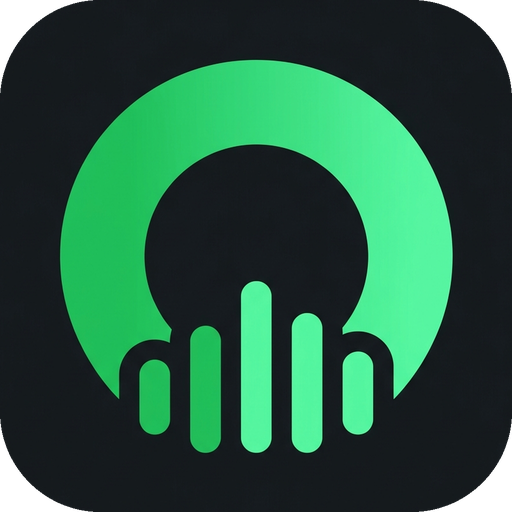
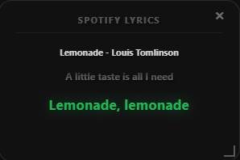

# Overtone

<p align="center">
  
</p>

<p align="center">
  <a href="https://bnbidipta.github.io/spotify-lyrics-overlay/"><strong>🌐 Landing page »</strong></a>
</p>

<p align="center">
  <a href="https://github.com/bnbidipta/spotify-lyrics-overlay/releases"></a>
  
  <a href="LICENSE.txt"></a>
</p>

**Overtone** is a tiny (< 2 MB) Windows desktop app that floats synced lyrics for whatever you're playing on Spotify in a borderless, glassy overlay. Built on **Neutralinojs** (native WebView2) with small compiled C# helpers, so it stays light where Electron apps weigh 150-300 MB.

<p align="center">
  
</p>

## Features

- **Synced lyrics** that scroll line-by-line, with word-by-word karaoke highlighting when the lyrics carry per-word timing.
- **Four lyric sources** tried in your chosen order: Lrclib, NetEase, Lyrics.ovh, and Musixmatch (opt-in, off by default). Manual search and paste-your-own `.lrc` when nothing is found.
- **Translation** of lyrics to English; Hindi lyrics also get a Roman-letter transliteration.
- **Sync tuning**: nudge forward/back (`[` / `]`, `\` to reset), a global offset slider, and a saved offset per song.
- **Player controls** on hover: album art, progress bar, previous / play-pause / next, and like-to-library.
- **Overlay window**: drag by the header, resize from the corner, pin always-on-top, or lock click-through. Opacity, blur, font, size and theme settings; ambient album-art glow.
- **One-click Spotify login** via PKCE (no client secret), with an optional custom client ID. The session is encrypted with Windows DPAPI and refreshed automatically.
- **Streamer mode**: an OBS browser source at `http://127.0.0.1:5001/overlay`.
- **Auto-launch with Spotify** (optional): opens when Spotify starts and closes when it exits.
- **Local lyrics cache** (last 50 songs) for instant replays.

## Quick start

1. Download the installer or `.zip` from [Releases](https://github.com/bnbidipta/spotify-lyrics-overlay/releases).
2. Run **Overtone** and click **Login with Spotify**.
3. Play a song on Spotify.

Settings, cache and the login session live in `%APPDATA%\Overtone`. Closing the window or choosing **Quit** from the tray icon exits the app fully.

## Building

Prerequisites: Node.js, the [WebView2 Runtime](https://developer.microsoft.com/en-us/microsoft-edge/webview2/) (preinstalled on Windows 10/11), the .NET Framework `csc.exe` (ships with Windows), and optionally [Inno Setup 6](https://jrsoftware.org/isinfo.php) for the installer.

```powershell
cd neutralino-app; npm install; npx @neutralinojs/neu update; cd ..
./build.ps1          # app + C# helpers + zip (+ installer if Inno Setup is installed)
```

`build_and_push.ps1` runs `build.ps1` and then commits, tags and pushes a release. CI (`.github/workflows/build.yml`) runs the same `build.ps1`.

```
├── neutralino-app/
│   ├── resources/            # index.html, styles.css, js/main.js, icons/
│   ├── neutralino.config.json
│   ├── auth_listener.cs      # OAuth loopback callback listener
│   ├── fetch_lyrics.cs       # multi-provider lyrics fetcher
│   ├── secure_store.cs       # DPAPI session storage
│   ├── window_utils.cs       # click-through, shortcuts, watcher registration
│   ├── spotify_watcher.cs    # auto-launch with Spotify
│   └── obs_server.cs         # OBS overlay server
├── docs/                     # landing page (GitHub Pages)
├── build.ps1                 # build + package
├── build_and_push.ps1        # build + release
└── installer.iss             # Inno Setup installer
```

## Roadmap

- Evaluate [Windows App SDK](https://github.com/microsoft/WindowsAppSDK) (WinUI 3) for a native rewrite. Not adopted for now: it would drop the < 2 MB footprint.

## Disclaimer

Overtone is not affiliated with, endorsed by, or sponsored by Spotify. Lyrics come from third-party services (Lrclib, NetEase, Lyrics.ovh and optionally Musixmatch) and are subject to their terms.

## License

[MIT](LICENSE.txt).
